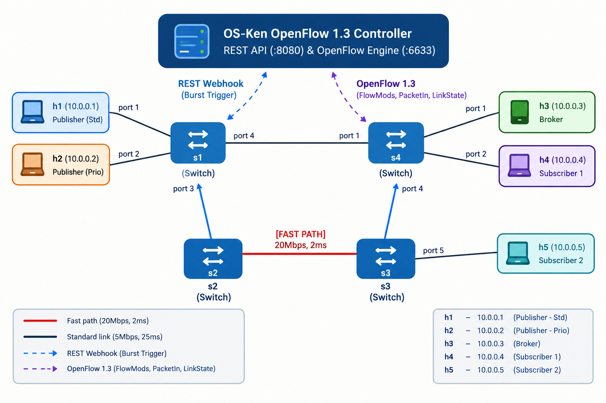

# Publish–Subscribe Messaging System over TCP with SDN

**Course:** Computer Networks (UE25CS243A) — SDN-Socket Programming Mini Project  
**Project Track:** Project #9 — Publish–Subscribe Messaging System  
**Total Marks:** 40 Marks (Deliverable 1: 15M | Deliverable 2: 25M)  
**Team Size:** 3 Members  

---

## 1. System Architecture

This project implements an end-to-end, dynamic publish–subscribe messaging infrastructure combining low-level **TCP socket programming** with **Software-Defined Networking (SDN)** flow steering.

<p align="center">
  <a href="docs/openflow_topology_diagram.png">
    
  </a>
  <br>
  <em>Figure 1: SDN-Integrated Publish–Subscribe Architecture & OpenFlow 1.3 Diamond Topology</em>
</p>

### OpenFlow 1.3 Multi-Path Topology

```
       +-------------------------------------------------------+
       |             OS-Ken OpenFlow 1.3 Controller            |
       |         REST API (:8080) & OpenFlow Engine (:6633)    |
       +---------------------------+---------------------------+
                                   ^
                     REST Webhook  |  OpenFlow 1.3
                   (Burst Trigger) |  (FlowMods, PacketIn, LinkState)
                                   v
+------------------+         +------------+             +------------------+
| h1 (10.0.0.1)    |--port 1-|            |             |                  |--port 1-- h3 (10.0.0.3)
| Publisher (Std)  |         |     s1     |             |        s4        |           Broker
+------------------+--port 2-|  (Switch)  |             |     (Switch)     |--port 2-- h4 (10.0.0.4)
| h2 (10.0.0.2)    |         +-----+------+             +-------+----------+           Subscriber 1
| Publisher (Prio) |               | \                         / |
+------------------+      port 3   |  \ port 4         port 4 /  | port 5  +------------------+
                                   |   \                     /   |         | h5 (10.0.0.5)
                                   |    \                   /    |         | Subscriber 2
                        [FAST PATH]|     \                 /     | [STD]   +------------------+
                      20Mbps, 2ms  |      \               /      | 5Mbps, 25ms
                                   v       v             v       v
                             +----------+               +----------+
                             |    s2    |               |    s3    |
                             | (Switch) |               | (Switch) |
                             +----------+               +----------+
```

### Key Technical Capabilities
1. **Length-Prefixed Framing Wire Protocol:** 4-byte unsigned big-endian integer header prefix (`!I`) guaranteeing that TCP byte-stream segments never suffer from concatenation or fragmentation.
2. **Concurrent Multi-Port Broker:** Concurrent TCP listener threads on port `5001` (High Priority) and port `5002` (Standard).
3. **Diamond Multi-Path Mininet Topology:**
   - **Upper Fast Path (`s1 -> s2 -> s4`):** Bandwidth: 20 Mbps, Propagation Delay: 2ms per hop.
   - **Lower Standard Path (`s1 -> s3 -> s4`):** Bandwidth: 5 Mbps, Propagation Delay: 25ms per hop.
4. **Dynamic Application-to-SDN Trigger:** When message volume on a standard topic exceeds the burst threshold ($\ge 15$ messages), the Broker triggers an HTTP `POST /sdn/policy` webhook to the SDN controller, which pushes OpenFlow rules to promote that host to the Fast Path mid-stream.
5. **Sub-Second Fast Failover:** When link `s1-s2` fails, the controller detects `OFPPS_LINK_DOWN` and immediately reroutes all traffic over the backup path (`s3`) with zero dropped connections.

---

## 2. Directory Structure

```text
sdn-tcp-pubsub/
├── controller/
│   └── sdn_controller.py       # Member 2: OS-Ken OpenFlow 1.3 Controller + REST Webhook API
├── topology/
│   └── pubsub_topo.py          # Member 2: 4-Switch Diamond Multi-Path Mininet Topology
├── docs/
│   ├── openflow_topology_diagram.png # OpenFlow 1.3 Network Architecture & Topology Diagram
│   ├── SDN_TCP_PubSub_Complete_Guide.md # Comprehensive course & architecture guide
│   └── Teammates_Project_Overview.md # 3-member execution & testing summary
├── gui.py                      # Minimal Tkinter Desktop GUI (side-by-side terminal panes)
├── tui.py                      # Responsive In-Terminal TUI (Curses with true black background & test runners)
├── run_local_demo.py           # Single-command automated demo runner
├── pubsub/
│   ├── protocol.py             # Member 1: Length-prefixed framing protocol
│   ├── broker.py               # Member 1 & 3: Multi-threaded TCP Broker + SDN webhook trigger
│   ├── subscriber.py           # Member 1: Concurrent TCP Subscriber with latency logging
│   └── publisher.py            # Member 1: TCP Publisher with topic priority support
├── benchmarks/
│   ├── plot_metrics.py         # Member 3: Latency & Scalability comparison graphs
│   └── sample_data/            # Sample latency CSV datasets for testing
│       ├── std_latency.csv
│       └── prio_latency.csv
├── tests/
│   └── test_pubsub.py          # Automated test suite for protocol, broker & triggers
├── requirements.txt            # Python dependencies (os-ken, requests, matplotlib)
├── TEAM_MEMBER_GUIDE.md        # Step-by-step execution guide for each member & OS
├── SDN_TCP_PubSub_Teammate_Handbook.pdf # PDF handbook for teammates & viva prep
└── README.md                   # Complete documentation, setup, and viva guide
```

> 📄 **PDF Handbook Available:** Download or share [SDN_TCP_PubSub_Teammate_Handbook.pdf](SDN_TCP_PubSub_Teammate_Handbook.pdf) with your teammates for a quick summary of roles, setup, step-by-step commands, and viva Q&A.  
> 📖 **Role-Specific Steps:** See [TEAM_MEMBER_GUIDE.md](TEAM_MEMBER_GUIDE.md) for individual Member 1, 2, and 3 commands across Arch Linux, Ubuntu VMs, and macOS.

---

## 3. Team Member Roles & Rubric Mapping (40 Marks Total)

| Member | Primary Role | Files Owned | Rubric Components Covered |
| :--- | :--- | :--- | :--- |
| **Member 1** | **TCP Socket & Pub–Sub Engine Lead** | `pubsub/protocol.py`<br>`pubsub/broker.py`<br>`pubsub/publisher.py`<br>`pubsub/subscriber.py`<br>`tui.py` | • TCP/UDP Socket Implementation (4M)<br>• Complete Application Functionality (4M)<br>• Wire Protocol & Framing |
| **Member 2** | **Mininet Topology & SDN Controller Lead** | `topology/pubsub_topo.py`<br>`controller/sdn_controller.py` | • Mininet + SDN Implementation (4M)<br>• Dynamic SDN Functionality (6M)<br>• Directed Loop-Free ARP |
| **Member 3** | **Integration, Testing & Evaluation Lead** | `benchmarks/plot_metrics.py`<br>`README.md`<br>Webhook logic in `broker.py` & `sdn_controller.py` | • Problem Understanding & Architecture (2M)<br>• Socket–SDN Integration (3M)<br>• Initial Testing & Demo (2M)<br>• Challenging Scenario / Robustness (4M)<br>• Performance Evaluation (5M)<br>• Documentation & Viva (6M) |

### 7-Minute Teacher Presentation Flow
1. **[0:00 - 2:00] Member 1:** Explains TCP framing challenges (`!I` header), multi-port Broker architecture, and launches `python3 tui.py` to demonstrate live publishing, routing, and `PUB_ACK`.
2. **[2:00 - 4:30] Member 2:** Explains the 4-switch Diamond topology, directed ARP loop prevention, and proactive OpenFlow 1.3 flow steering rules (`tcp_dst=5001` vs `5002`).
3. **[4:30 - 7:00] Member 3:** Demonstrates dynamic SDN burst promotion (>15 msgs), simulates link failure & sub-second failover (`link s1 s2 down`), and presents the empirical latency comparison plot (55ms vs 6ms).

> 📖 **Comprehensive Script & Viva Defense:** Full word-for-word speech scripts and individual viva answers are documented in [TEAM_MEMBER_GUIDE.md](TEAM_MEMBER_GUIDE.md).

---

## 4. Environment Setup

### Option A: Arch Linux / CachyOS (Native)
```bash
sudo pacman -Syu mininet openvswitch iproute2 iperf3 wireshark-qt python-pip uv
sudo systemctl enable --now ovs-vswitchd.service ovsdb-server.service

uv venv --python 3.11 .venv
source .venv/bin/activate
uv pip install -r requirements.txt
```

### Option B: Ubuntu 22.04 LTS (Native / VirtualBox / VMware / UTM VM)
```bash
sudo apt update && sudo apt upgrade -y
sudo apt install mininet openvswitch-switch iproute2 iperf3 python3-pip python3-venv git -y

python3 -m venv .venv
source .venv/bin/activate
pip install -r requirements.txt
```

### Quick Verification & Minimal GUIs
```bash
# Option A: Minimal Tkinter Desktop GUI (3 side-by-side terminal panes)
python3 gui.py

# Option B: Responsive In-Terminal TUI (Pure black background & live test runner)
python3 tui.py

# TUI Interactive Controls & Tests:
#   [B] Toggle Broker (:5001 Priority, :5002 Standard)
#   [S] Toggle Subscriber ('sensors/temp' on port 5002)
#   [P] Test 1: Publish 1 Standard message
#   [2] Test 2: Publish 5 Priority messages
#   [X] Test 3: Burst 16 messages (Triggers SDN Promotion)
#   [A] Run Automated End-to-End Demo (All tests sequentially)
#   [U] Run Unit Test Suite (tests/test_pubsub.py with live stream)
#   [L] Toggle Layout Mode (Stacked Full-Width <-> Split 2-Column)
#   [C] Clear Consoles  |  [Q] Clean Exit

# Option C: Automated Local Test Runner
python3 run_local_demo.py

# Option D: Verify Mininet and OVS
sudo mn --switch ovsbr --test pingall
sudo mn -c

# Run automated Pub-Sub unit tests
python3 -m unittest discover -s tests -p "test_*.py" -v
```

---

## 5. Step-by-Step Execution Guide

### Deliverable 1: Raw TCP Socket Pub-Sub Demo (Standalone Mode)
You can demonstrate the socket application even before launching Mininet:

```bash
# Terminal 1: Run the Broker (listeners on 5001 and 5002)
python3 pubsub/broker.py --priority-port 5001 --std-port 5002

# Terminal 2: Start a Subscriber for standard topic
python3 pubsub/subscriber.py --broker 127.0.0.1 --port 5002 --topics sensors/temp --csv std_latency.csv

# Terminal 3: Start a Subscriber for priority topic
python3 pubsub/subscriber.py --broker 127.0.0.1 --port 5001 --topics alerts/fire --csv prio_latency.csv

# Terminal 4: Publish messages
python3 pubsub/publisher.py --broker 127.0.0.1 --port 5002 --topic sensors/temp --count 20 --interval 0.2
```

---

### Deliverable 2: Mininet + Dynamic SDN Evaluation

#### Step 1: Start the SDN Controller (Terminal 1)
```bash
# If using Bash/Zsh:
source .venv/bin/activate
osken-manager --ofp-tcp-listen-port 6633 controller/sdn_controller.py

# If using Fish shell (CachyOS default), either activate using .fish:
source .venv/bin/activate.fish
osken-manager --ofp-tcp-listen-port 6633 controller/sdn_controller.py

# OR run directly without activating:
.venv/bin/osken-manager --ofp-tcp-listen-port 6633 controller/sdn_controller.py
```

#### Step 2: Launch the Mininet Diamond Topology (Terminal 2)
```bash
sudo mn -c
sudo python3 topology/pubsub_topo.py
```
Inside the `mininet>` prompt, verify network reachability:
```text
mininet> pingall
```

#### Step 3: Start the Broker and Subscribers in Mininet
Inside `mininet>`:
```text
mininet> h3 python3 pubsub/broker.py --sdn-url http://127.0.0.1:8080 > broker.log 2>&1 &
mininet> h4 python3 pubsub/subscriber.py --broker 10.0.0.3 --port 5002 --topics sensors/temp --csv std_latency.csv > sub_std.log 2>&1 &
mininet> h5 python3 pubsub/subscriber.py --broker 10.0.0.3 --port 5001 --topics alerts/fire --csv prio_latency.csv > sub_prio.log 2>&1 &
```

#### Step 4: Run Publishers to Demonstrate Dynamic Topic Promotion
Publish 25 messages from `h1` (standard) and `h2` (priority):
```text
mininet> h1 python3 pubsub/publisher.py --broker 10.0.0.3 --port 5002 --topic sensors/temp --count 25 --interval 0.3
mininet> h2 python3 pubsub/publisher.py --broker 10.0.0.3 --port 5001 --topic alerts/fire --count 25 --interval 0.3
```

Check subscriber logs to witness the latency drop after message #15:
```text
mininet> sh tail -n 25 sub_std.log
```
Inspect OpenFlow flow tables on `s1` to see the installed priority 50 dynamic rules:
```text
mininet> sh ovs-ofctl -O OpenFlow13 dump-flows s1
```

#### Step 5: Challenging Scenario — Link Failure & Fast Failover
While high-priority publishing is active, simulate a link failure:
```text
mininet> link s1 s2 down
```
Observe the SDN controller output:
```text
[SDN-FAILOVER] Fast Path Link (s1-s2) DOWN! Rerouting all flows via s3.
```
Traffic seamlessly switches to `s3` with zero socket disconnections. To restore:
```text
mininet> link s1 s2 up
```

#### Step 6: Generate Performance Evaluation Graphs
Exit Mininet (`mininet> exit`) and plot the collected benchmark data:
```bash
python3 benchmarks/plot_metrics.py std_latency.csv prio_latency.csv latency_comparison.png
```
Or test with the bundled sample dataset:
```bash
python3 benchmarks/plot_metrics.py benchmarks/sample_data/std_latency.csv benchmarks/sample_data/prio_latency.csv latency_comparison.png
```

---

## 6. Viva Preparation & Answers

### Questions for Member 1 (Socket Lead)
- **Q: Why use a 4-byte length prefix instead of delimiting by newlines (`\n`) or calling `sock.recv(1024)`?**  
  *Answer:* TCP is an unstructured byte-stream protocol. A single `recv()` call can return partial JSON or multiple aggregated messages. The 4-byte integer header (`struct.pack("!I", len)`) allows the receiver to know the exact byte boundary and buffer until the complete frame arrives.
- **Q: How does the Broker handle concurrent subscribers safely?**  
  *Answer:* Mutations to the `self.subscriptions` dictionary are synchronized with `threading.Lock()`. During broadcast, it takes a snapshot copy `list(self.subscriptions[topic])` so iteration is unaffected by concurrent joins or drops.

### Questions for Member 2 (SDN Lead)
- **Q: Why can't a basic learning switch (like `simple_switch_13`) work on this topology?**  
  *Answer:* The diamond topology forms a physical Layer-2 loop (`s1-s2-s4-s3-s1`). Standard broadcast flooding causes an infinite ARP broadcast storm. Our controller uses directed, loop-free ARP handling and installs explicit point-to-point OpenFlow 1.3 rules.
- **Q: How does the switch differentiate topic priority at wire speed?**  
  *Answer:* OpenFlow matches on Layer-4 destination TCP ports (`tcp_dst=5001` vs `tcp_dst=5002`) in `OFPMatch`. Packets are steered into their respective output ports directly in switch hardware/kernel space.

### Questions for Member 3 (Integration & Benchmarks Lead)
- **Q: How does the application dynamically trigger SDN changes?**  
  *Answer:* The Broker tracks per-topic message volume. Upon crossing the burst threshold ($\ge 15$), it issues an HTTP `POST` to the SDN Controller's REST API (`/sdn/policy`). The controller then installs higher-priority OpenFlow rules (`priority=50`) overriding default path rules (`priority=30`).
- **Q: What quantitative latency improvement is observed?**  
  *Answer:* End-to-end delivery latency drops from $\sim 55\text{–}60\text{ ms}$ on the standard 5 Mbps / 25ms path (`s3`) down to $\sim 6\text{–}10\text{ ms}$ once promoted to the 20 Mbps / 2ms fast path (`s2`).
